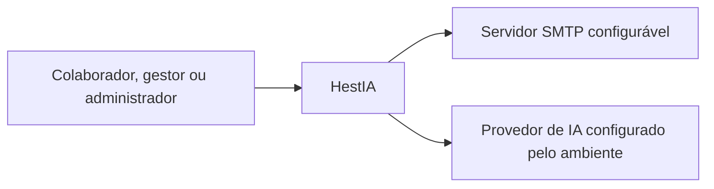
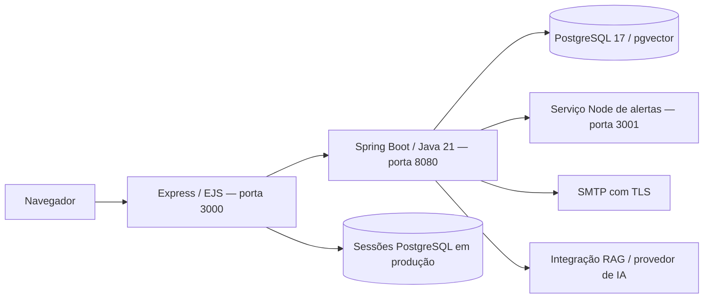

# Arquitetura e contratos — alterações locais da Sprint 4

Base Git: develop, dd9259e. Alterações desta entrega ainda não possuem commit de release. Este documento descreve o código local e não comprova implantação na internet.

## Contexto C4

O colaborador consulta conteúdo publicado, registra usos e confirma ciência. O gestor acompanha seu departamento e solicita novas tentativas. ADMIN administra usuários, configuração e curadoria da empresa. Ciência de política não aprova conformidade.

## Containers C4

O navegador usa cookie de sessão HTTP-only; o BFF envia o token da API no contexto da requisição. Em produção, o cookie exige HTTPS e as sessões ficam no PostgreSQL. O Compose de release pressupõe proxy HTTPS no host, mantém banco e API sem portas públicas e não ativa demonstração. O ambiente atual do usuário é localhost.

## Decisões e dados

- V25: ciência por usuário e revisão de política, com unicidade e data.
- V26: conteúdo persistido, versões imutáveis e estados RASCUNHO, EM_REVISAO, PUBLICADO, RETIRADO. A publicação cria a avaliação no motor de aprendizagem existente. Retirar preserva versões, provas e históricos.
- V27: fila de avaliação por uso e histórico de tentativas. O registro e a fila pertencem à mesma transação. Só depois do commit o processamento inicia em nova transação.
- A revisão de política é selecionada entre as versões conhecidas no instante do uso e fica congelada na fila. Nenhuma ou várias políticas aplicáveis geram revisão explícita.
- A avaliação utiliza a entidade existente e o evento ConformidadeRegistrada; os consumidores criam tratamento e capacitação com referências existentes. Bloqueio do registro de processamento impede duas avaliações concorrentes. Os efeitos transacionais são revertidos juntos em falha.
- O catálogo de demonstração só é usado com hestia.catalogo.demonstracao=true. O catálogo operacional começa vazio e requer conteúdo autorizado da equipe.
- Mudança de perfil, departamento, empresa ou atividade revoga as sessões abertas. Alterar apenas nome não revoga.

- V28: evidências conferidas por responsável e matriz imutável dos critérios por processamento.

## Contratos acrescentados

| API | Finalidade e acesso |
| --- | --- |
| GET/PUT /empresas/{id}/configuracao-inicial | ADMIN da própria empresa; leitura de pendências e salvamento de parâmetros existentes |
| GET/POST /catalogo-treinamentos | ADMIN; listar/criar rascunho |
| GET /catalogo-treinamentos/{id} | ADMIN da empresa; conteúdo e avaliação para curadoria |
| POST /catalogo-treinamentos/{id}/estado | ADMIN; revisar, publicar ou retirar com motivo |
| GET /aprendizagem/conteudos | Conteúdo publicado da empresa, reaproveitando aprendizagem |
| GET /ciencias-politica e /historico | Políticas e histórico do próprio usuário |
| POST /ciencias-politica/{versaoId} | Registrar ciência da versão vigente sem duplicar |
| GET /avaliacoes-automaticas | Colaborador próprio; gestor do departamento; ADMIN da empresa |
| POST /avaliacoes-automaticas/{id}/tentar-novamente | Gestor do departamento ou ADMIN; resultado concluído não é refeito |
| GET /relatorios-uso e /exportar | Mesma consulta, filtros e escopo; CSV protegido contra fórmulas |
| POST /auth/recuperacao | Solicitação existente conectada a entrega SMTP |
| POST /auth/recuperacao/redefinir | Token de uso único, válido por 30 minutos; nova senha entre 8 e 100 caracteres |
| GET /actuator/health | Estado da API e suas dependências monitoradas, sem detalhes internos |
| GET /health no frontend | Disponibilidade do processo Node |

As telas correspondentes estão no menu: Configuração inicial, Catálogo de treinamentos, Ciência de políticas, Avaliações automáticas e Relatório de usos. O login tem Recuperar senha.

## Limites reais

A regra automática 2.1 usa estados por critério. V28 preserva referências conferidas por gestor/ADMIN no escopo autorizado, com autoria/data; a matriz do resultado fica ligada ao processamento. Evidência ausente é NAO_VERIFICADO. Critério crítico comprovadamente não atendido prevalece; aprovação exige todos atendidos. Não há análise automática de dados confidenciais: a conferência humana deve relacionar referência minimizada à regra da política. O estado da ferramenta só é tratado como contemporâneo para uso informado no instante da captura, e registros retrospectivos permanecem limitados. A política preserva revisão e hash. Reavaliação de mérito após resultado não é a retentativa técnica e não foi acrescentada nesta etapa.

As exportações implementadas incluem usos, resultados de maturidade e evolução de apurações persistidas. Os endpoints /relatorios-maturidade/resultados(.csv) e /evolucao(.csv) delegam aos serviços existentes. As telas preservam ausência de dados, natureza, parâmetros e comparabilidade. A integração dos painéis de risco e economia depende dos contratos de SCRUM-580/581/582, ainda A fazer no Jira. As consultas existentes desses módulos não foram substituídas.

SMTP, hospedagem, domínio, proxy HTTPS, monitoramento externo, retenção externa de backups e publicação automatizada no host não estão homologados. Ver operação e evidências em ../scrum/SPRINT4-operacao.md.
